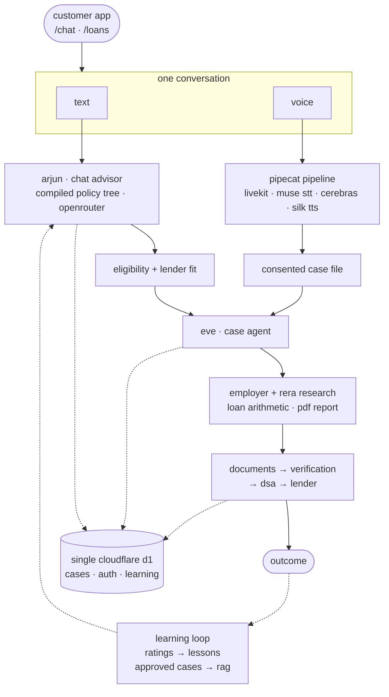

## what i built

- **policy fit**: lender policy compiled into a typescript policy tree. the model reads a compact index and pulls only the nodes it needs, no vector db.
- **case agent**: researches employer and rera registries, runs deterministic loan math, renders a pdf case report.
- **voice calls**: pipecat over livekit webrtc, one consented case file at the end, no backend calls mid-call.
- **learning loops**: rated conversations become operator lessons, approved cases become a rag corpus with holdout evals.

## the voice agent

silero vad + smart turn for endpointing, muse for stt, qwen 27b on cerebras for the spoken loop, rumik silk for tts.

the hard part is turn-taking. silence can't tell "eighty lakh" (done) from "two point" (not done), so every reply is marked finished, cut off or still thinking, and only finished ends the turn.

stt is muse, biased to english + hindi, because multilingual deepgram once heard "dwarka" as "walker". context gets compacted with arithmetic instead of a summarizer, which could invent a figure. if a response ever comes back empty, a fallback line plays, so there's no dead air.

## how it fits together

one conversation in, one case file out, then fulfillment and learning underneath.

## why it matters

a home loan is months of discovery, documents, verification and follow-ups. the product only ever claims readiness, never approval. the work is making that chain feel like one calm conversation.

<Outcomes
  items={[
    { metric: "chat + voice", label: "one conversation" },
    { metric: "discovery → dsa", label: "eligibility to close" },
    { metric: "live", label: "in production" },
  ]}
/>
