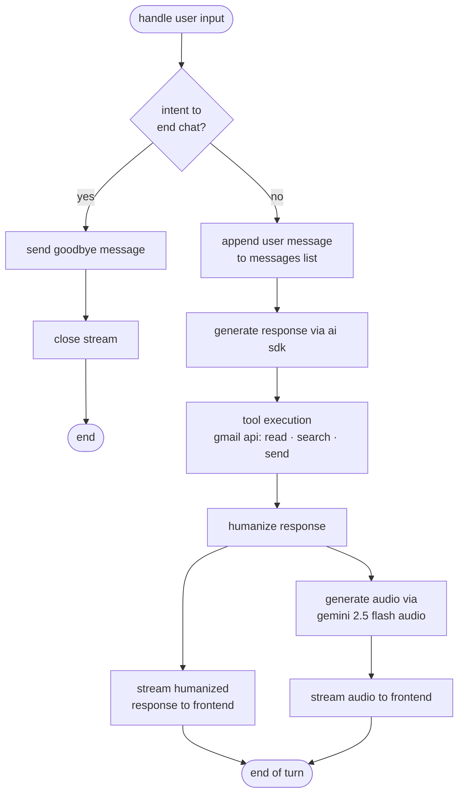
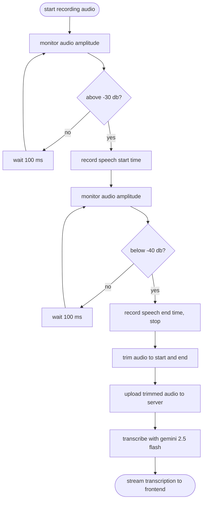

## agent workflow

every turn checks if you're done. if not, the model runs with gmail tools, then the reply streams back as text and audio in parallel.

## voice activity detection

speech gets cut on the phone before upload. it starts above -30 db, stops below -40 db, checked every 100 ms.

